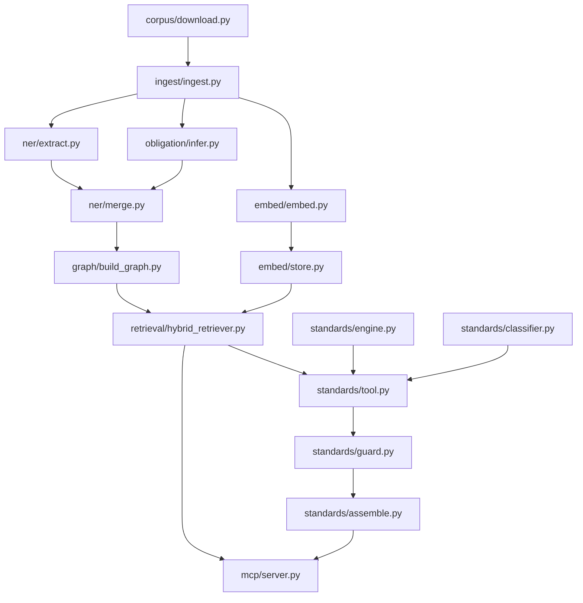
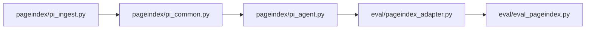

# regclaw

Regulatory clause retrieval with a knowledge graph, exact vector search, and a standards applicability tool; a document-tree agent is planned alongside it.

[](https://github.com/hariom-s27/regclaw/actions/workflows/ci.yml)
[](.github/workflows/ci.yml)
[](#licence-and-contact)

> Independent, from-scratch rebuild on public substitute documents.
> No employer code, data, documents, prompts, or results are included.
> All published measurements describe this rebuild.
> Corpus files remain local and are not distributed here.
> See [SCOPE.md](SCOPE.md) for provenance and attribution.

## Demo

**Demo GIF: TBD** - record the fixture-backed MCP and applicability workflow before adding media.

## Quickstart

Use [Python 3.11](.github/workflows/ci.yml); this path needs no keys or PDFs.

```powershell
git clone https://github.com/hariom-s27/regclaw.git
cd regclaw
python -m venv .venv
.venv/Scripts/Activate.ps1
python -m pip install -r mcp/requirements_mcp.txt pytest PyMuPDF PyYAML jsonschema hypothesis
$env:REGCLAW_STUB = "1"
$env:LANGFUSE_ENABLED = "false"
python tasks.py test
```

### Full mode (needs API keys + your own downloaded corpus)

Use the pinned research environment in [requirements.txt](requirements.txt).
Copy [.env.example](.env.example) locally and configure credentials.
Supply your own downloaded public corpus and acquisition metadata.
Document sources and reuse conditions are in [CORPUS.md](CORPUS.md).
The commands below describe a live workflow; the quickstart above stays offline.

```powershell
python -m pip install -r requirements.txt
python tasks.py up
python tasks.py ingest
python tasks.py graph --load --from-clauses --checks
python tasks.py embed --live
$env:REGCLAW_STUB = "0"
python mcp/server.py
```

The clauses-only graph mode is useful for the first storage check.
It does not populate extracted entities or standard references.
Use the enrichment workflow before judging the completed graph design.
The embedding command uses a live provider and stores production vectors.
Complete the input-size check before requesting embeddings.
The live server needs both graph and vector services.

Full-mode settings are documented by the empty environment template.
The principal settings are:

| Setting | Purpose |
|---|---|
| `NEO4J_URI` | Graph endpoint |
| `NEO4J_USER`, `NEO4J_PASSWORD` | Local graph authentication |
| `PG_DSN` | Postgres connection |
| `ANTHROPIC_API_KEY` | Configured generation adapters |
| `OPENAI_API_KEY` | Configured embedding adapter |
| `REGCLAW_STUB` | Fixture or live MCP backend |
| `LANGFUSE_ENABLED` | Opt-in manual observations |

Keep tracing off while checking the basic storage path.
When tracing is enabled, configure its credentials separately.
The SDK kill switch also stops manual client creation.
The environment template contains empty values and no usable credentials.

Successful tests establish contracts and fallback behavior.
The live graph command additionally checks stored data and reload counters.
A separate embedding reconciliation is needed after vector loading.
Use judged queries to assess retrieval quality only after both stores are ready.
The current measured and pending work is listed in [results](docs/results.md).

The full extraction and obligation pipeline has separate prerequisites.
Entity extraction uses the configured model adapter and grounded validation.
Obligation inference requires a trained model and independently labeled gold.
The merge step joins those outputs under the implemented data contract.
A successful storage check does not substitute for those model evaluations.

Inspect command options before selecting a live operation:

```powershell
python tasks.py ner --help
python tasks.py enrich --help
python tasks.py graph --help
python tasks.py embed --help
```

The applicability examples can also run without services:

```powershell
python tasks.py standards-demo
```

That command explicitly uses fixture clients.
It demonstrates response structure and guard behavior.
Its outputs are not model-quality measurements.

The MCP server uses stdio transport.
The host application owns the protocol stream.
Diagnostics go to stderr.
Do not paste interactive text into the server's stdout channel.
The input and response contracts are in [architecture](docs/architecture.md).

## Architecture

### Part I: literature retrieval and applicability



The retriever's four stages filter ids, rank vectors, expand neighbours, and fetch text
([implementation](retrieval/hybrid_retriever.py)). Neo4j owns text; Postgres holds vectors.
Applicability combines a deterministic rule floor with a guarded optional classifier.
The managed-transaction fix preserves read routing and applies a callback timeout.
Tracing is optional and captures counts and usage without prompts or clause bodies.

### Part II: document-tree workflow, planned evaluation



The agent navigates a document tree, fetches physical pages, and verifies citations.
A complete Part II corpus and evaluation run is TBD.
Detailed schemas and storage boundaries are in [architecture](docs/architecture.md).

## Results

All values below describe the public substitute corpus.
Commands and captured output are in [results](docs/results.md).
The source code commit and measurement dates are recorded there.
No synthetic fixture timing or fixture quality metric is reported here.

| Measurement | Rebuild result | Command and captured output |
|---|---|---|
| Parsed clauses | 1,143 | [`python tasks.py graph --load --from-clauses --checks`](docs/results.md#graph-plan-and-live-verification) |
| Live graph and reload | 1,159 nodes / 1,163 relationships; check #13 PASS | [`python tasks.py graph --load --from-clauses --checks`](docs/results.md#graph-plan-and-live-verification) |
| EPA raw / policy F1 | 0.992593 / 1.000000 | [`python tasks.py structure-score`](docs/results.md#structure-scoring) |
| EU MDR raw / policy F1 | 0.989101 / 0.998650 | [`python tasks.py structure-score`](docs/results.md#structure-scoring) |
| Policy parent accuracy | 100% for both scored documents | [`python tasks.py structure-score`](docs/results.md#structure-scoring) |
| Automated matrix cross-check | 0 mismatches in 264 cells | [`standards.crosscheck.crosscheck`](docs/results.md#matrix-cross-check) |
| Largest embedding input / oversized inputs | 7,250 tokens / 0 | [`python tasks.py embed --dry-run`](docs/results.md#embedding-input-size) |
| Obligation agreement (post-practice) | kappa 0.894990, 95% CI [0.832293, 0.947318] | [`python tasks.py gold-agreement` -> `data/gold/agreement.json`](docs/results.md#obligation-gold-and-classifier) |
| Obligation Delta macro-F1 (LegalBERT - regex) | -0.072138, 95% CI [-0.143915, +0.005000]; inconclusive | [`python tasks.py gold-score data/gold/gold_final.csv --predictions data/gold/pred_legalbert.json --output data/gold/scores_legalbert.json`](docs/results.md#obligation-gold-and-classifier) |
| Offline tests | 292 passed | [`python tasks.py test` -> `data/gold/tests_phase_d.txt`](docs/results.md#obligation-gold-and-classifier) |

| Unmeasured area | Status | Reason |
|---|---|---|
| Full entity extraction accuracy | TBD | Live extraction and human evaluation pending |
| Production embedding reconciliation | TBD | Production vectors not loaded |
| Retrieval quality and full pipeline latency | TBD | Judged queries and complete live run pending |
| Part II quality and latency | TBD | Document confirmation and evaluation pending |

The heading-policy view retains official structural parents kept by the parser.
Raw official scores remain visible alongside it.
The remaining official EU missing unit still reduces recall.
A perfect parent score does not establish complete body-text coverage.
The automated matrix cross-check has not been marked human verified.
The results page states the current live-service verification outcome separately.

## Key decisions

- [Obligation labels](docs/decisions/0001-none-obligation.md): descriptive text has an explicit NONE label.
- [Direct storage clients](docs/decisions/0004-direct-drivers.md): candidate boundaries remain visible in code.
- [Number-derived hierarchy](docs/decisions/0005-number-hierarchy.md): neighbours need no new graph relationship.
- [Optional tracing](docs/decisions/0010-manual-tracing.md): manual spans record counts and model usage.
- [Per-component profiles](docs/decisions/0014-device-profile.md): contact and exposure belong to each component.
- [Exact vector ranking](docs/decisions/0017-exact-pgvector.md): exclude approximate-index recall from evaluation.
- [Rules as a floor](docs/decisions/0019-hybrid-applicability.md): the classifier cannot downgrade a rule decision.
- [Official structure gold](docs/decisions/0023-official-structure.md): source numbering checks the parser independently.

The complete [decision index](docs/decisions/README.md) records accepted and proposed choices.
Each record names its confirmation or states that none exists yet.
An accepted design does not imply measured live performance.

## Repository map

| Path | Responsibility |
|---|---|
| `corpus/`, `ingest/` | Acquisition, parsing, validation, and structural scoring |
| `ner/` | Grounded entities, normalisation, references, and merge |
| `obligation/`, `goldset/` | Weak labels, annotation, training, and scoring |
| `graph/` | Metadata, loader, graph checks, and duplicate reports |
| `embed/` | Token guards, embeddings, and exact vector storage |
| `retrieval/`, `retrieval_eval/` | Hybrid retrieval, judged pools, and metrics |
| `standards/` | Profile, matrix rules, classifier, guard, and provenance |
| `mcp/` | Tools, resources, and protocol tests |
| `pageindex/`, `eval/` | Document trees, page tools, and planned evaluation |
| `observability/`, `tests/` | Optional tracing, summaries, and offline tests |
| `docs/` | Architecture, decisions, results, and journal |

## Testing and CI

Run `python tasks.py test`; the current local total is [292 passes](docs/results.md#obligation-gold-and-classifier)
(`data/gold/tests_phase_d.txt`).
Stub mode supplies canned MCP data and injected model, graph, and vector clients.
It verifies contracts and guard behavior; model quality and service latency need live runs.
[CI](.github/workflows/ci.yml) selects Python 3.11 and the same runner; remote status is TBD until pushed.
Run live graph checks with `python tasks.py graph --load --from-clauses --checks`; tracing tests stay offline.

## Corpus and licensing

There are no PDFs in this repo.
[CORPUS.md](CORPUS.md) lists sources, editions, recorded digests, and licence conditions.
Some sources have non-commercial, share-alike, or permission-required terms.
Source files remain local; check the source-specific conditions before reuse.

## Limitations and next steps

- Record the demo GIF; the walkthrough placeholder remains TBD until media exists.
- Finish manual parser gold; automatic structure checks cover only the supported sources.
- Address the exhausted weak-MAY training pool in a future approved split; current gold comparison is inconclusive ([results](docs/results.md#obligation-gold-and-classifier)).
- Run entity extraction and inspect grounding failures before loading the enriched graph.
- Load production vectors and judge retrieval results before publishing quality or latency.
- Confirm the Part II document and complete indexing, citation checks, and evaluation.
- Recheck graph quality after entity loading; the current clauses-only graph has the expected check #4 WARN ([results](docs/results.md)).

## Licence and contact

Repository code licence: **TBD**; a licence has not been selected or added.
The badge reports that pending choice rather than implying permission.
Document licences are listed separately in [CORPUS.md](CORPUS.md).

Contact: [Hariom Singh](https://github.com/hariom-s27).
Project: [regclaw](https://github.com/hariom-s27/regclaw).
