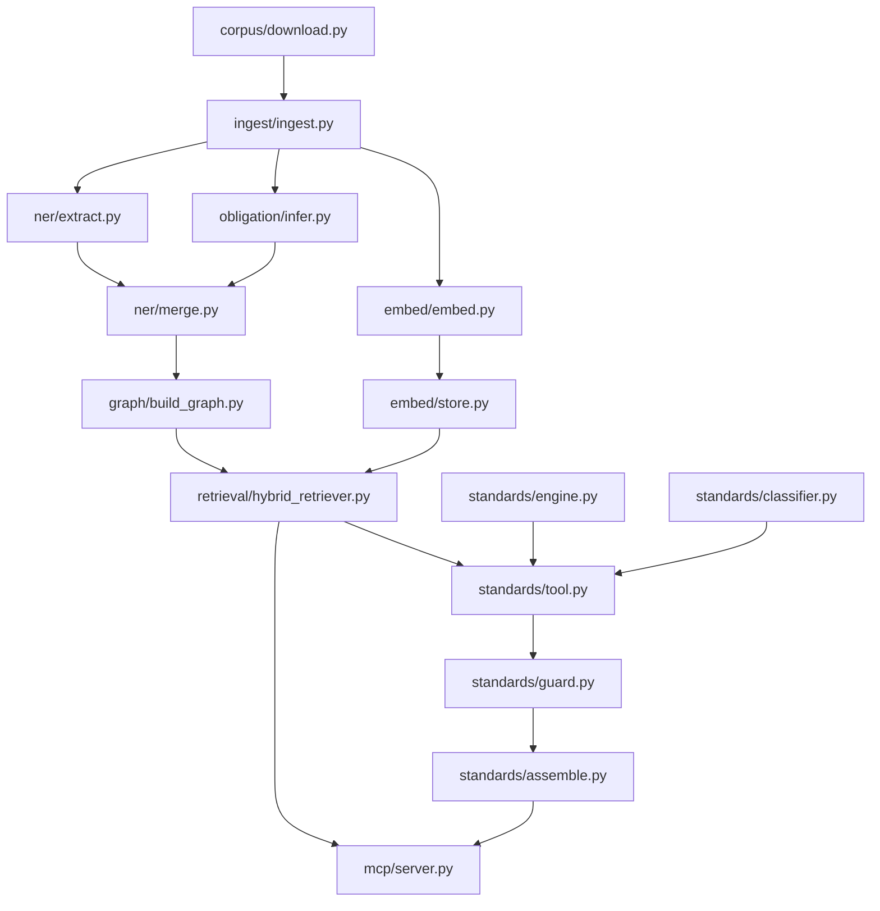
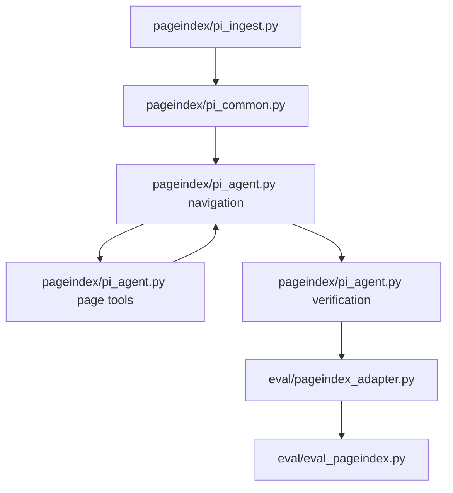

# Architecture and implemented contracts

This describes the implementation. Live status is in [results.md](results.md).
Part II remains planned for a complete corpus and evaluation run.

## Part I flow



The embedder reads clauses or enriched rows; title and text determine its input.
The graph loader uses enriched rows normally, or an explicit clauses-only mode.
That mode supplies no extracted entities or standard references.
The graph owns clause text; Postgres stores vectors keyed by clause id.

## Clause rows

Exactly nine fields are enforced by `ingest/validate.py` and
`tests/test_ingest.py::test_validator_rejects`:

| Field | Meaning |
|---|---|
| `id` | Stable `doc:number`, unique merge key |
| `doc` | Configured source code |
| `number` | Original numbering style including retained group prefixes |
| `title` | Own or inherited title |
| `text` | Own body text, with deeper capped content merged |
| `parent` | Nearest kept ancestor id, or null |
| `source_pdf` | Local PDF filename |
| `page` | Physical PDF page, starting at 1 |
| `informative` | Boolean informational-block flag |

Sources: `ingest/validate.py`, `ingest/ingest.py`, `CLAUDE.md`.
The page convention is also implemented in `pageindex/pi_common.py`.
EU pages refer to the locally sliced PDF.

Merge adds `obligation`, `obligation_flags`, `entities`, and `iso_refs`.
Obligation labels are SHALL, SHOULD, MAY, NONE; null is rejected.
Entities contain canonical strings under `biological_effects`, `chemicals`,
`device_types`, `regulatory_actors`, `lifecycle_phases`, and `keywords`.
Sources: `ner/merge.py`, `ner/validate_enriched.py`, `tests/test_merge.py`.
Mention/evidence objects remain in extraction side files. Footnotes also stay separate.

## Graph

The allow-list and merge statements live in `graph/build_graph.py`.

| Label | Key and properties |
|---|---|
| `Clause` | Unique `id`; `number`, `title`, `text`, `obligation` |
| `Standard` | Unique `id`; `number`, optional `title`, optional `edition` |
| `Module` | Unique `name` |
| `LifecyclePhase` | Unique `name` |
| `RegulatoryAuthority` | Unique `name` |
| `Chemical` | Unique `name` |
| `BiologicalEffect` | Unique `name` |
| `DeviceType` | Unique `name` |
| `RegulatoryActor` | Unique `name` |

| Relationship | Direction |
|---|---|
| `BELONGS_TO` | Clause to Standard; Standard to Module |
| `MENTIONS` | Clause to Chemical, BiologicalEffect, DeviceType, RegulatoryActor, or LifecyclePhase |
| `REGULATED_BY` | Standard to RegulatoryAuthority |
| `REFERENCES` | Clause to Standard |

Referenced standards outside the corpus are stubs with `id` and `number`.
They have no fabricated clauses. Keywords have no graph label.
Neighbours derive from clause-number strings and common Standard membership.
There are no clause-to-clause hierarchy edges.
The retriever creates the `clause_text_ft` full-text index at startup.

## Vector storage

```sql
CREATE TABLE IF NOT EXISTS clause_embeddings (
    clause_id text PRIMARY KEY,
    embedding vector(1536)
);
```

Source: `embed/store.py`; dimensions are fixed in `embed/embed.py` too.
There is no ANN index. The store rejects HNSW or IVFFlat indexes at startup.
Confirmation: `tests/test_embed.py::test_sql_contract_upsert_ann_and_mock_connection`.
Ranking uses candidate ids and cosine distance with an explicit result limit.
Exact ranking concerns available stored vectors, not semantic relevance.

Input is `title + "\n" + text`. The hard ceiling is 8,191 tokens
(`embed/embed.py`, `embed/token_stats.py`). Oversized input stops before requests
or storage. Model: `text-embedding-3-small` (`embed/embed.py`).
The local manifest carries input hashes and run metadata outside the table.

## MCP schemas

Sources of truth: `mcp/server.py`, `standards/profile.py`,
`standards/guard.py`, and `standards/assemble.py`.

`query_regulatory_knowledge(query, top_k)` requires at least three query characters.
`top_k` is from 1 to 50, default 10, from the server's Field constraints.
The response is:

```text
RetrievalResult = {query, candidate_count, max_score, clauses}
Clause = {clause_id, standard, number, title, text, obligation, score, source}
source = ranked | neighbour
```

Obligation and score may be null in the MCP response model.
Enriched stored obligations still follow the non-null contract.

`get_applicable_standards(device_profile)` accepts DeviceProfile.v1.
Input is strict, forbids extras, and rejects explicitly supplied nulls.
Optional fields may be omitted. `framework` defaults to `FDA_2023_ATTACHMENT_A`.

| Profile level | Fields |
|---|---|
| Device | `device_name`, `framework`, `target_markets`, `intended_population`, `labeled_non_pyrogenic`, `device_specific_standards`, `components` |
| Component | `name`, `contact_nature`, `contact_site`, `contact_mode`, `contacts_csf_lymph_or_cardiovascular`, `extracorporeal_circuit`, `reproductive_tissue_contact`, `exposure`, `materials`, `sterilization`, `existing_evidence` |
| Exposure | `pattern`, `hours_per_use`, `uses_per_patient`, `contact_days`, `total_exposure_period_days`, `reasonably_foreseeable_misuse` |
| Material | `name`, `material_class`, `novel`, `absorbable_or_degradable`, `in_situ_polymerizing`, `submicron_or_nano`, `conforms_to_material_standard`, `master_file` |
| Existing evidence | `equivalent_marketed_device`, `chemical_characterization_iso_10993_18`, `toxicological_risk_assessment_iso_10993_17` |

Required device fields: `device_name` and nonempty `components`.
Required component fields: `name`, `contact_nature`, `contact_site`, `exposure`,
nonempty `materials`, and `sterilization`. Exposure requires `pattern`;
material requires `name`. `derived` is engine-owned and rejected on input.
Frameworks are `FDA_2023_ATTACHMENT_A`, `ISO_10993_1_2018`, and `ISO_10993_1_2025`.
Contact nature is `non_contact`, `surface`, `externally_communicating`, or `implant`.
Other enums and defaults are defined in `standards/profile.py`.

The assembled response is:

```text
{
  device_name, framework, standards, notes, assumptions, caveat,
  provenance: {
    engine_version, data_version, model, prompt_sha256, llm_status,
    disagreements, generated_at
  }
}
```

Each standard includes `part`, `edition`, `label`, `endpoints`, `rule_trace`,
`suggested_route`, `reason`, `clause_ids`, `unsupported_by_corpus`,
`superseded_edition`, `framework_row_unverified`, and `edition_unverified`.
The current guard emits `llm_status` as `ok` or `fallback`; refusal and token-limit
failures appear in disagreements and return fallback. This follows the implemented
response rather than expanding an older specification's status enum.

Rules classify endpoints per component, then roll up to parts and the device.
The optional classifier may upgrade a label. The guard takes the stronger label,
validates retrieved ids, drops unknown parts, and replaces banned wording.
The caveat comes verbatim from `standards/data/labels.v1.yaml`.

The stage-filter callback uses `neo4j.unit_of_work(timeout=self.timeout)` and
passes a string to `ManagedTransaction.run`; `Session.execute_read` keeps read
routing. Confirmation: `tests/test_retrieval_driver.py`.

## Manual tracing

`observability/tracing.py` is off by default through `LANGFUSE_ENABLED`.
The disabled path returns a null context without importing Langfuse.
`LANGFUSE_TRACING_ENABLED=false` also prevents client creation.
SDK version 5.0.1 is pinned in `requirements.txt` after local signature inspection.

The `retriever` root has sibling children `neo4j.cypher`, `embed.query`,
`pgvector.rank`, `neighbour.expand`, and `text.fetch`.
`cypher.generate` is nested under graph filtering as a generation.
`standards.classify` and `ner.extract` are generations.
PageIndex records `pageindex.agent`, `pageindex.navigate`, `pageindex.verify`,
and `pageindex.tool` with agent, generation, generation, and tool types.
These manual spans capture no prompts or clause bodies.
Metadata comes from materialised outputs.

`observability/run_summary.py` reads API response pages or an offline fixture.
Named durations use end minus start timestamps, with sample counts per row.
Retriever self time subtracts the union of direct-child intervals.
Nested or overlapping spans are not added to their parents.
The module implements nearest-rank P50/P95.
The legacy summary retains compatibility for latency-only rows.

## Part II: planned live evaluation



Physical pages start at 1; conversion is in `pageindex/pi_common.py`.
Golden rows use `id`, `question`, `reference`, and `gold_pages`
(`eval/eval_pageindex.py`). Document identity, trees, model quality, and evaluation
results remain TBD. Proposed mode choices are in the [decision index](decisions/README.md).
